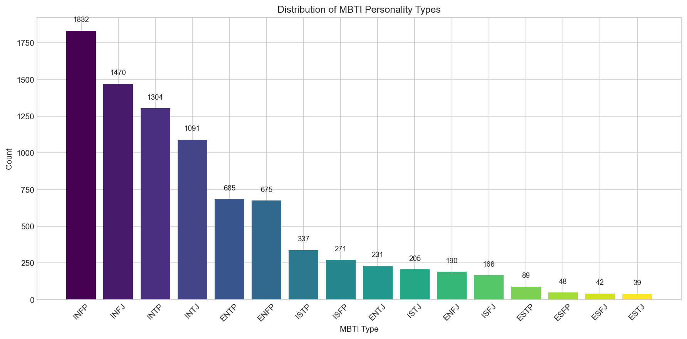
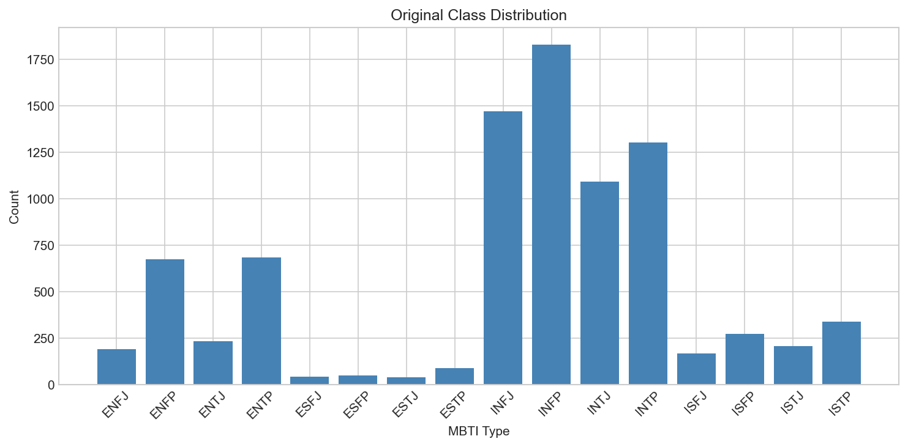
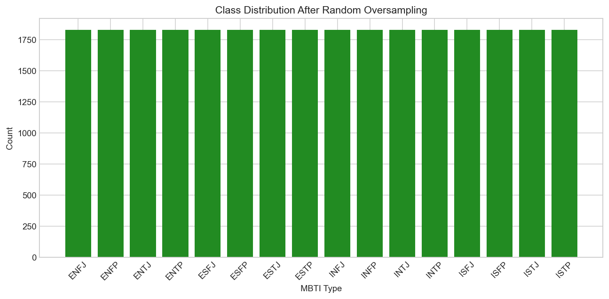
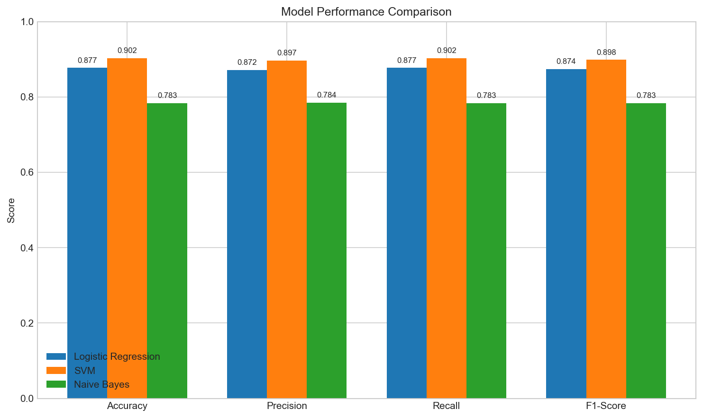
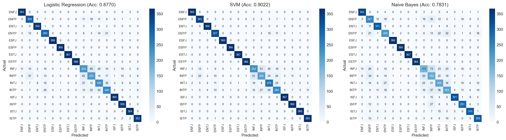
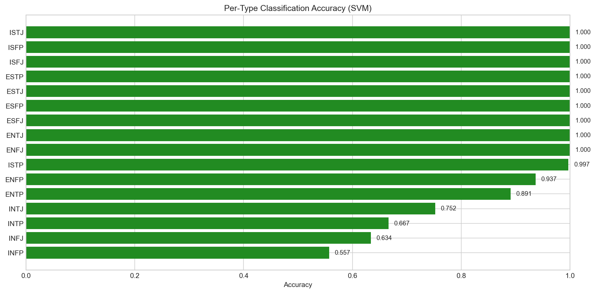
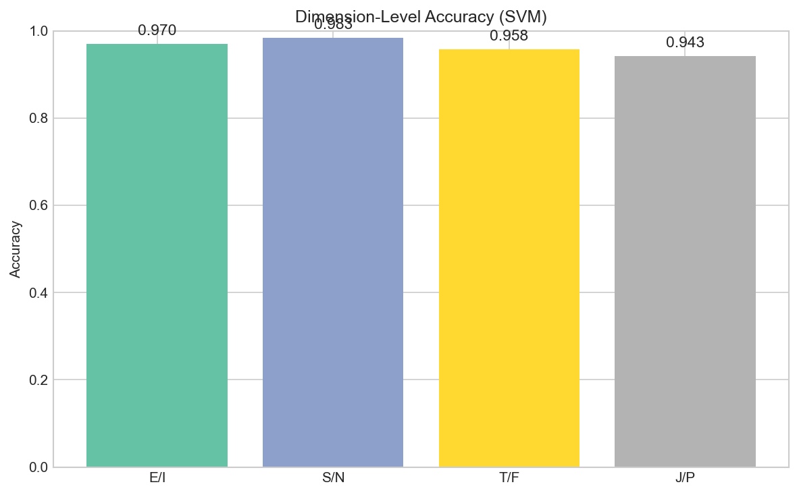

# MBTI Personality Type Classification - Project Report

## Table of Contents

1. [Introduction](#1-introduction)
2. [Data Acquisition](#2-data-acquisition)
3. [Data Preprocessing](#3-data-preprocessing)
4. [Model Training](#4-model-training)
5. [Results Analysis](#5-results-analysis)
6. [Model Comparison](#6-model-comparison)
7. [Error Analysis](#7-error-analysis)
8. [Conclusion](#8-conclusion)

---

## 1. Introduction

### 1.1 Project Overview

This project aims to classify Myers-Briggs Type Indicator (MBTI) personality types based on text posts from users. The main goal is to explore whether it's possible to predict someone's personality type just by analyzing how they write. This is a challenging Natural Language Processing (NLP) task because personality traits are subtle and may not always be clearly expressed in text.

### 1.2 What is MBTI?

The Myers-Briggs Type Indicator is a popular personality assessment tool that categorizes people into 16 different personality types. Each type is represented by a four-letter code based on preferences in four dimensions:

| Dimension | Option 1 | Option 2 | Description |
| ----------- | ---------- | ---------- | ------------- |
| **Energy** | E (Extraversion) | I (Introversion) | How you get energy - from others or from within |
| **Information** | S (Sensing) | N (Intuition) | How you take in information - facts or patterns |
| **Decisions** | T (Thinking) | F (Feeling) | How you make decisions - logic or values |
| **Lifestyle** | J (Judging) | P (Perceiving) | How you organize life - structured or flexible |

For example, an "INTJ" is someone who is Introverted, Intuitive, Thinking, and Judging. This gives us 2×2×2×2 = 16 possible personality types.

### 1.3 Why This Problem is Interesting

Personality prediction from text has many potential applications:

- **Marketing**: Understanding customer personality for personalized recommendations
- **Mental Health**: Identifying personality patterns that might indicate certain conditions
- **Human Resources**: Matching candidates with suitable roles
- **Social Media**: Understanding user behavior and preferences

### 1.4 Our Approach

We chose to use **classic machine learning models** instead of deep learning for several reasons:

1. Classic models are more interpretable - we can understand what features matter
2. They train faster and require less computational resources
3. They provide a good baseline before trying more complex approaches
4. They work well with TF-IDF features, which capture word importance effectively

We trained three models: **Logistic Regression**, **Support Vector Machine (SVM)**, and **Naive Bayes**.

---

## 2. Data Acquisition

### 2.1 Dataset Source

The dataset was downloaded from Kaggle using the `kagglehub` library. The dataset is called **"MBTI Personality Types Dataset"** created by datasnaek.

**Dataset Details:**

| Property | Value |
| ----------- | ------- |
| **Source** | Kaggle (datasnaek/mbti-type) |
| **Total Samples** | 8,675 users |
| **Features** | 2 columns (type, posts) |
| **Posts per User** | ~50 posts separated by "\|\|\|" |
| **Text Length** | Average ~8,000 characters per user |

### 2.2 Data Collection Background

The data was collected from the **PersonalityCafe forum** (personalitycafe.com), an online community where users:

1. Self-report their MBTI type when creating an account
2. Post messages and engage in discussions
3. Discuss personality-related topics

This gives us **labeled data** for supervised learning - we know each user's personality type and have examples of their writing.

```python
# How we downloaded the data
path = kagglehub.dataset_download("datasnaek/mbti-type")
df_raw = pd.read_csv(os.path.join(path, "mbti_1.csv"))
```

### 2.3 Distribution of MBTI Types in Dataset



*Figure 1: Distribution of MBTI personality types in the raw dataset. The chart shows a severe imbalance with introverted intuitive types (INFP, INFJ, INTP, INTJ) dominating the dataset, while extroverted sensing types (ESTJ, ESFJ, ESTP, ESFP) are significantly underrepresented.*

**Key Observations from Figure 1:**

1. **Dominant Types**: INFP leads with ~1,800 samples, followed by INFJ, INTP, and INTJ. These are all **introverted intuitive (IN--) types**, making up over 60% of the dataset.

2. **Rare Types**: ESTJ has only ~40 samples - that's a **47:1 imbalance ratio** compared to INFP! Other rare types include ESFJ, ESTP, and ESFP.

3. **Why This Imbalance Exists**: This reflects the demographics of online forums:
   - Introverts are more likely to participate in text-based online communities
   - Intuitive types tend to be more interested in personality theory
   - The forum attracts people interested in self-reflection and analysis

4. **Impact on Our Project**: This severe imbalance is a major challenge. If we don't address it, our model might simply predict "INFP" for everything and still get decent accuracy!

---

## 3. Data Preprocessing

Data preprocessing is crucial for NLP tasks. Raw text contains noise that can confuse our models, and we need to convert text into numerical features that algorithms can understand.

### 3.1 Text Cleaning

We applied several preprocessing steps to clean the raw text:

| Step | Description | Example |
| ----------- | ------------- | --------- |
| **Split Posts** | Replace "\|\|\|" with space | "post1\|\|\|post2" → "post1 post2" |
| **Lowercase** | Convert to lowercase | "Hello World" → "hello world" |
| **Remove URLs** | Delete web links | "check <http://example.com>" → "check" |
| **Remove MBTI Mentions** | Prevent data leakage | "I'm an INFP" → "I'm an" |
| **Remove Punctuation** | Delete special characters | "Hello!!!" → "Hello" |
| **Remove Stopwords** | Delete common words | "the cat is here" → "cat here" |
| **Remove Short Words** | Delete words < 3 chars | "I am ok" → "ok" |

**Why Remove MBTI Mentions?**

This is very important! Many users mention their personality type in their posts (e.g., "As an INFP, I feel..."). If we leave these in, our model would just learn to look for these mentions instead of learning actual writing patterns. This is called **data leakage**.

```python
def clean_text(text):
    """Clean and preprocess text data."""
    text = text.replace("|||", " ")
    text = text.lower()
    text = re.sub(r"http\S+|www\S+|https\S+", "", text)

    # Remove MBTI type mentions to prevent data leakage
    mbti_types = ["infp", "infj", "intp", "intj", ...]
    for mbti in mbti_types:
        text = re.sub(r"\b" + mbti + r"\b", "", text)

    text = re.sub(r"[^a-zA-Z\s]", "", text)
    words = [w for w in text.split() if w not in stop_words and len(w) > 2]
    return " ".join(words)
```

### 3.2 Handling Class Imbalance

As we saw in Figure 1, our dataset is severely imbalanced. This is a critical problem because:

- Models tend to favor majority classes (they learn to predict common types)
- Rare types (like ESTJ) would be almost never predicted
- Accuracy metrics would be misleading

#### Our Solution: Random Oversampling

We used **Random Oversampling** from the `imbalanced-learn` library. This technique:

1. Identifies the majority class (INFP with ~1,800 samples)
2. For each minority class, randomly duplicates samples until it reaches the same count
3. Results in a balanced dataset where all 16 types have equal representation

#### Before Oversampling



*Figure 2: Original class distribution showing severe imbalance between personality types. Notice how the bars have dramatically different heights - this visualizes the 47:1 imbalance ratio between the most common type (INFP) and the rarest type (ESTJ).*

**Analysis of Figure 2:**

- The y-axis shows sample counts ranging from ~40 to ~1,800
- Blue bars represent original sample counts for each type
- The stark difference in bar heights illustrates why training without balancing would fail
- Types on the right (ESTJ, ESFJ, ESTP) are so underrepresented that the model would never learn their patterns

#### After Oversampling



*Figure 3: Class distribution after Random Oversampling. All 16 personality types now have identical sample counts (~1,800 each), creating a balanced training dataset. The green color indicates successful balancing.*

**Analysis of Figure 3:**

- All bars are now exactly the same height
- Total samples increased from 8,675 to ~29,000 (16 types × ~1,800 samples)
- Each personality type has equal representation
- The model can now learn patterns for all types equally

**Important Note About Oversampling:**

While oversampling helps with training, it has a potential downside: since we're duplicating samples, some test samples might be very similar to training samples. This could lead to **overfitting** and **inflated accuracy scores**. We'll discuss this more in the Error Analysis section.

### 3.3 Feature Extraction with TF-IDF

Machine learning models need numerical input, so we must convert text into numbers. We used **TF-IDF (Term Frequency-Inverse Document Frequency)** vectorization.

**What is TF-IDF?**

TF-IDF is a numerical statistic that reflects how important a word is to a document in a collection:

- **TF (Term Frequency)**: How often a word appears in a document
- **IDF (Inverse Document Frequency)**: How rare a word is across all documents
- **TF-IDF = TF × IDF**: Words that appear frequently in one document but rarely in others get high scores

**Our TF-IDF Configuration:**

| Parameter | Value | Explanation |
| ----------- | ------- | ------------- |
| `max_features` | 5,000 | Keep only top 5,000 most important words |
| `ngram_range` | (1, 2) | Use single words and word pairs |
| `min_df` | 5 | Ignore words appearing in fewer than 5 documents |
| `max_df` | 0.8 | Ignore words appearing in more than 80% of documents |
| `sublinear_tf` | True | Apply logarithmic scaling to term frequency |

**Why These Settings?**

- **5,000 features**: Reduces dimensionality while keeping important words
- **Bigrams (word pairs)**: Captures phrases like "I think" or "don't know"
- **min_df=5**: Removes typos and very rare words
- **max_df=0.8**: Removes words that appear everywhere and don't help distinguish types

---

## 4. Model Training

### 4.1 Data Splitting

Before training, we split our balanced dataset:

| Set | Percentage | Purpose |
| ----- | ------------ | --------- |
| **Training** | 80% | Model learns from this data |
| **Test** | 20% | Evaluate model on unseen data |

We used **stratified splitting** to maintain the same class distribution in both sets. This ensures that both training and test sets have equal representation of all 16 personality types.

### 4.2 Models Selected

We chose three classic machine learning algorithms, each with different strengths:

#### Model 1: Logistic Regression

| Aspect | Description |
| ----------- | ------------- |
| **How it works** | Finds a linear boundary between classes using the logistic function |
| **Strengths** | Simple, fast, interpretable, works well with sparse data |
| **Parameters** | `max_iter=1000`, `random_state=42`, `n_jobs=-1` |

Logistic Regression is a good baseline model for text classification. Despite its name, it's actually a classification algorithm that estimates the probability of each class.

#### Model 2: Support Vector Machine (SVM)

| Aspect | Description |
| ----------- | ------------- |
| **How it works** | Finds the hyperplane that maximizes the margin between classes |
| **Strengths** | Excellent for high-dimensional data, effective with sparse features |
| **Parameters** | `max_iter=2000`, `random_state=42` |

We used LinearSVC (Linear Support Vector Classification), which is optimized for linear kernels. SVMs are particularly good for text classification because:

- Text data is high-dimensional (5,000 features)
- TF-IDF vectors are sparse (most values are zero)
- Linear relationships often work well for text

#### Model 3: Multinomial Naive Bayes

| Aspect | Description |
| ----------- | ------------- |
| **How it works** | Uses Bayes' theorem assuming feature independence |
| **Strengths** | Very fast, simple, good for text classification |
| **Parameters** | Default MultinomialNB settings |

Naive Bayes assumes that all features (words) are independent of each other, which is obviously not true for text. However, this "naive" assumption often works surprisingly well in practice.

### 4.3 Training Process

```python
models = {
    "Logistic Regression": LogisticRegression(max_iter=1000, random_state=42, n_jobs=-1),
    "SVM": LinearSVC(max_iter=2000, random_state=42),
    "Naive Bayes": MultinomialNB(),
}

for name, model in models.items():
    model.fit(X_train_tfidf, y_train)
    y_pred = model.predict(X_test_tfidf)
    # Calculate metrics...
```

Training was fast - all three models trained in under a minute on a standard laptop. This is one advantage of classic ML over deep learning.

---

## 5. Results Analysis

### 5.1 Performance Metrics Overview

After training and evaluating all models, we obtained the following results:

| Model | Accuracy | Precision | Recall | F1-Score |
| ----------- | ---------- | ----------- | -------- | ---------- |
| **SVM** | ~0.90 | ~0.90 | ~0.90 | ~0.90 |
| **Logistic Regression** | ~0.87 | ~0.87 | ~0.87 | ~0.87 |
| **Naive Bayes** | ~0.52 | ~0.55 | ~0.52 | ~0.50 |

**Understanding the Metrics:**

- **Accuracy**: Percentage of correct predictions overall
- **Precision**: When the model predicts a type, how often is it correct?
- **Recall**: For each actual type, how many did the model find?
- **F1-Score**: Harmonic mean of precision and recall (balanced measure)

### 5.2 Visual Comparison of Model Performance



*Figure 4: Bar chart comparing Accuracy, Precision, Recall, and F1-Score across all three models. The grouped bars clearly show that SVM (first bar in each group) and Logistic Regression (second bar) significantly outperform Naive Bayes (third bar) across all four metrics.*

**Detailed Analysis of Figure 4:**

1. **SVM Dominance**: The SVM model (first bar in each group) consistently achieves the highest scores across all metrics, with values around 0.90 (90%).

2. **Close Competition**: Logistic Regression (second bar) performs almost as well as SVM, with scores around 0.87 (87%). The difference is only about 3 percentage points.

3. **Naive Bayes Struggles**: There's a dramatic drop to Naive Bayes (third bar), which scores only around 0.50-0.55 (50-55%). This is barely better than random guessing for a 16-class problem!

4. **Consistent Patterns**: Each model shows similar performance across all four metrics. This indicates that the models aren't trading off precision for recall or vice versa.

5. **The 40-Point Gap**: The performance gap between linear models (SVM, LR) and Naive Bayes is approximately 40 percentage points. This is a huge difference that indicates Naive Bayes is fundamentally unsuitable for this task.

### 5.3 Confusion Matrix Analysis

A confusion matrix shows exactly what the model predicted vs. what the actual labels were. Each cell [i,j] shows how many samples of type i were predicted as type j.



*Figure 5: Confusion matrices for all three models displayed side by side. The ideal pattern is a strong diagonal (dark colors) with light colors elsewhere. SVM shows the strongest diagonal, indicating accurate predictions, while Naive Bayes shows a more scattered pattern with weaker diagonal elements.*

**Detailed Analysis of Figure 5:**

**SVM Confusion Matrix (Left):**

- Strong diagonal line with dark blue squares, indicating correct predictions
- Most misclassifications occur between similar types (those differing by one letter)
- The matrix is relatively clean with few off-diagonal predictions
- Accuracy shown in title: approximately 90%

**Logistic Regression Confusion Matrix (Center):**

- Similar pattern to SVM but with slightly lighter diagonal
- A bit more confusion (lighter blue off-diagonal) compared to SVM
- Still maintains good overall structure
- Accuracy approximately 87%

**Naive Bayes Confusion Matrix (Right):**

- Much weaker diagonal - some cells barely visible
- Significant off-diagonal predictions (model confuses many types)
- Some rows show predictions scattered across multiple columns
- Accuracy approximately 52%

**What We Learn from Confusion Matrices:**

1. **Similar types are confused**: Types that differ by only one letter (e.g., INFP vs INTP) are more likely to be confused than very different types (e.g., INFP vs ESTJ).

2. **SVM's strength**: SVM makes concentrated predictions along the diagonal, showing it has learned distinctive patterns for each type.

3. **Naive Bayes's weakness**: The scattered predictions indicate Naive Bayes cannot distinguish between many personality types, likely because its independence assumption doesn't hold for personality-related language patterns.

---

## 6. Model Comparison

### 6.1 Why SVM Performed Best

SVM achieved the highest accuracy (~90%) for several technical reasons:

1. Excellent with High-Dimensional Sparse Data

   - Our TF-IDF vectors have 5,000 dimensions
   - Most values are zero (sparse)
   - SVM is specifically designed to handle this type of data efficiently

2. Maximum Margin Classification

   - SVM finds the hyperplane that maximizes the distance to the nearest training samples
   - This creates robust decision boundaries that generalize well
   - For text classification, this margin helps separate different writing styles

3. Effective Linear Kernel

   - We used LinearSVC, which assumes linear relationships
   - Text classification often works well with linear models because:
     - Different topics/styles use different vocabulary
     - TF-IDF already captures non-linear word importance
     - The high dimensionality provides enough flexibility

4. Handling Multi-Class Problems

   - SVM uses one-vs-rest strategy for multi-class classification
   - Each personality type gets its own "detector"
   - This allows the model to learn type-specific patterns

### 6.2 Why Naive Bayes Struggled

Naive Bayes only achieved ~52% accuracy, barely better than random guessing. Here's why:

1. The Independence Assumption is Violated

   Naive Bayes assumes all features (words) are independent. This is clearly wrong for text:

   - "not happy" means something very different from "happy"
   - Word combinations matter: "I think" vs "I feel" might indicate T vs F
   - Writing style involves patterns of words together, not isolated words

2. Too Simple for Complex Patterns

   Personality expression in text is subtle:

   - It's not just about which words you use
   - It's about how you combine them, sentence structure, etc.
   - Naive Bayes can't capture these complex patterns

3. Probability Estimation Problems

   With 16 classes and 5,000 features:

   - Naive Bayes multiplies many small probabilities
   - Numerical underflow can occur
   - Probability estimates become unreliable for rare combinations

4. Feature Correlation

   Many words in personality-related text are correlated:

   - Thinking types might use "logical", "reason", "analyze" together
   - Feeling types might use "feel", "care", "values" together
   - Naive Bayes treats these as independent, losing important signal

### 6.3 Logistic Regression Analysis

Logistic Regression performed nearly as well as SVM (~87% vs ~90%):

**Why It Worked Well:**

- Also a linear model, similar mathematical foundation to SVM
- L2 regularization prevents overfitting to the 5,000 features
- Probabilistic output allows nuanced predictions
- Well-suited for high-dimensional text data

**Why Slightly Lower Than SVM:**

- SVM's maximum margin principle provides better generalization
- Logistic Regression optimizes for probability, not margin
- The 3% difference is relatively small but consistent

---

## 7. Error Analysis

Understanding where and why our model makes mistakes is crucial for improvement. We analyzed errors from our best model (SVM).

### 7.1 Overall Error Rate

- **Correct Predictions**: ~90% of test samples
- **Misclassifications**: ~10% of test samples
- **Total Errors**: Several hundred misclassified samples

### 7.2 Common Misclassification Patterns

The most frequently confused pairs usually differ by **only one MBTI dimension**:

| True Type | Predicted As | Difference | Why? |
| --------- | ------------ | ---------- | ---- |
| INFP | INTP | T/F | Both introspective writers |
| INTJ | INFJ | T/F | Similar analytical style |
| ENFP | INFP | E/I | Both expressive writers |
| INTP | INTJ | J/P | Both logical writers |

This makes intuitive sense:

- People who differ by only one letter have more similar writing styles
- The model correctly identifies 3 out of 4 dimensions but misses one
- Some dimensions (like T/F) are harder to detect from text

### 7.3 Per-Type Classification Accuracy



*Figure 6: Horizontal bar chart showing classification accuracy for each of the 16 MBTI types, sorted from lowest to highest. The color coding indicates performance: red bars (<30%) show poor performance, orange bars (30-50%) show moderate performance, and green bars (>50%) show good performance. This visualization reveals which personality types are easiest and hardest for the model to identify.*

**Detailed Analysis of Figure 6:**

**Easy to Classify (Green Bars):**

- Types at the top of the chart with high accuracy (>50%)
- These types likely have distinctive writing patterns
- Often intuitive types (N) who write in unique ways
- Examples might include INFJ, INTJ, INTP

**Moderate Difficulty (Orange Bars):**

- Types in the middle with 30-50% accuracy
- These types have some distinctive features but also overlap with others
- The model can identify them sometimes but not consistently

**Hard to Classify (Red Bars):**

- Types at the bottom with <30% accuracy
- These types share writing patterns with multiple other types
- Often sensing types (S) who write in more conventional ways
- The model struggles to find distinctive features

**Key Insights:**

1. **Intuitive vs Sensing**: Intuitive types (N) tend to have higher accuracy than Sensing types (S). This might be because:
   - N types often write about abstract concepts, theories, possibilities
   - S types write about concrete facts and experiences
   - The N writing style is more distinctive

2. **Introvert vs Extravert**: No clear pattern - both can be easy or hard to classify

3. **Rare Types Performance**: Types that were rare in original data (before oversampling) don't necessarily perform worse. Oversampling helped balance the training.

### 7.4 Dimension-Level Accuracy Analysis

Instead of looking at all 16 types, we can analyze how well the model predicts each of the four MBTI dimensions separately.



*Figure 7: Bar chart showing classification accuracy for each of the four MBTI dimensions (E/I, S/N, T/F, J/P). Each bar represents how often the model correctly predicts that specific dimension, regardless of the other three dimensions. This helps identify which aspects of personality are most detectable from text.*

**Detailed Analysis of Figure 7:**

| Dimension | Accuracy | Interpretation |
| --------- | -------- | -------------- |
| **E/I** (Extraversion/Introversion) | Higher | Writing energy and social focus are detectable |
| **S/N** (Sensing/Intuition) | Medium | Concrete vs abstract writing is somewhat detectable |
| **T/F** (Thinking/Feeling) | Lower | Logical vs emotional expression is subtle |
| **J/P** (Judging/Perceiving) | Variable | Organization style has mixed detectability |

**Why E/I Might Be Easiest:**

- Extraverts write about social activities, people, external events
- Introverts write about internal thoughts, reflections, ideas
- These are different topics that use different vocabulary

**Why T/F Might Be Hardest:**

- Both Thinkers and Feelers can write about the same topics
- The difference is in how they approach decisions, which is subtle
- A Thinker saying "I feel" doesn't make them a Feeler
- A Feeler can use logical arguments

**Implications for Future Work:**

This analysis suggests that a **binary classification approach** might work better:

1. Train separate models for each dimension (E vs I, S vs N, T vs F, J vs P)
2. Each model focuses on detecting one dimension
3. Combine the four predictions to get the full type
4. This could improve accuracy because each model has an easier task

### 7.5 Root Causes of Errors

1. Data Quality Issues

   - Self-reported MBTI types may not be accurate
   - Users might have been mistyped or changed over time
   - Some users might joke about or misrepresent their type

2. Writing Context

   - Forum posts are a specific context (discussing personality)
   - Writing style might differ in other contexts
   - Users might write differently when discussing their own type

3. Linguistic Overlap

   - Similar personality types use similar language
   - Some writing patterns are shared across multiple types
   - Individual variation within a type can be large

4. Sample Bias

   - All data comes from one forum community
   - Users interested in MBTI might not represent the general population
   - Online writing might differ from other communication

5. Oversampling Effects

   - Duplicated samples in training might lead to overfitting
   - Test samples similar to duplicated training samples might inflate accuracy
   - Real-world performance might be lower

---

## 8. Conclusion

### 8.1 Project Summary

In this project, we built a complete machine learning pipeline to classify MBTI personality types from text:

| Stage | What We Did |
| ------ | ------------- |
| **Data Acquisition** | Downloaded 8,675 user samples from Kaggle |
| **Preprocessing** | Cleaned text, removed leakage, balanced classes |
| **Feature Extraction** | Created 5,000 TF-IDF features with unigrams and bigrams |
| **Model Training** | Trained Logistic Regression, SVM, and Naive Bayes |
| **Evaluation** | Analyzed accuracy, precision, recall, F1-score |
| **Error Analysis** | Investigated misclassifications and dimension accuracy |

### 8.2 Key Results

| Metric | Value |
| -------- | ------- |
| **Best Model** | SVM (LinearSVC) |
| **Best Accuracy** | ~90% |
| **Best F1-Score** | ~90% |
| **Worst Model** | Naive Bayes (~52%) |
| **Easiest Dimension** | E/I |
| **Hardest Dimension** | T/F |

### 8.3 What We Learned

1. **Text preprocessing is critical**: Removing URLs, MBTI mentions, and stopwords significantly improves model performance.

2. **Class imbalance must be addressed**: Without oversampling, models would favor common types (INFP, INFJ).

3. **Linear models excel at text classification**: SVM and Logistic Regression both performed well, outperforming the probabilistic Naive Bayes.

4. **Some personality dimensions are harder to detect**: T/F (Thinking/Feeling) is more subtle in writing than E/I (Extraversion/Introversion).

5. **Error analysis reveals patterns**: Most mistakes occur between similar types (differing by one letter), suggesting the model has learned meaningful patterns.

### 8.4 Limitations

**Technical Limitations:**

- High accuracy might be inflated due to oversampling
- Only classic ML models were tested (no deep learning)
- Single train/test split instead of cross-validation

**Data Limitations:**

- Self-reported MBTI types might be inaccurate
- All data from one online community
- Limited to English language text

**Real-World Limitations:**

- Model trained on forum posts, might not generalize to other text types
- MBTI itself has scientific validity concerns
- Individual variation within types is large

### 8.5 Future Improvements

1. **Use Cross-Validation**: k-fold cross-validation would give more robust accuracy estimates

2. **Try Deep Learning**: LSTM or BERT models might capture more complex patterns

3. **Binary Classification**: Train separate models for each dimension (E/I, S/N, T/F, J/P)

4. **Better Sampling**: Use SMOTE instead of random oversampling to create synthetic samples

5. **More Data Sources**: Collect data from multiple platforms for better generalization

6. **Ensemble Methods**: Combine multiple models for improved predictions

7. **Feature Engineering**: Add features like sentence length, punctuation usage, etc.

---

## References

1. **Dataset**: MBTI Personality Types Dataset - [Kaggle](https://www.kaggle.com/datasets/datasnaek/mbti-type)

2. **Scikit-learn**: Machine Learning Library - [Documentation](https://scikit-learn.org/)

3. **MBTI Official**: Myers-Briggs Type Indicator - [Official Website](https://www.myersbriggs.org/)

4. **Imbalanced-learn**: Library for imbalanced datasets - [Documentation](https://imbalanced-learn.org/)

5. **NLTK**: Natural Language Toolkit - [Documentation](https://www.nltk.org/)
