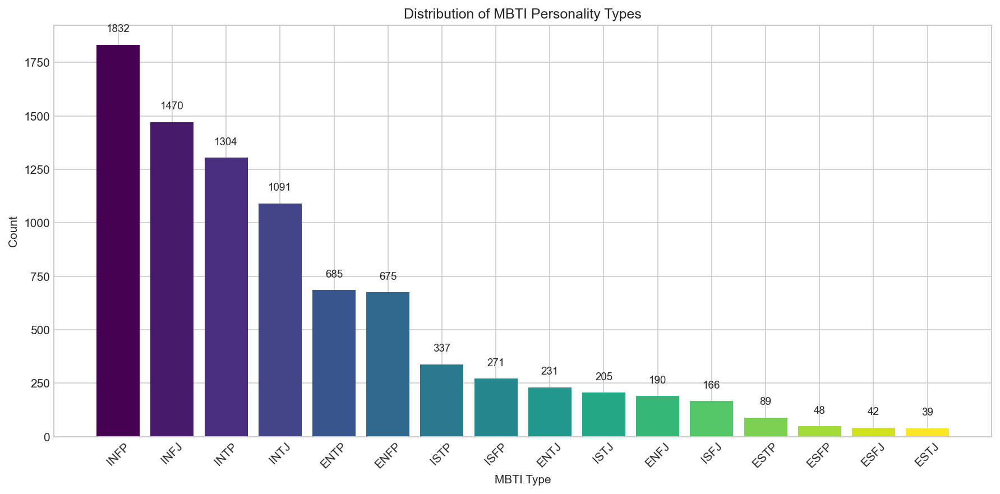
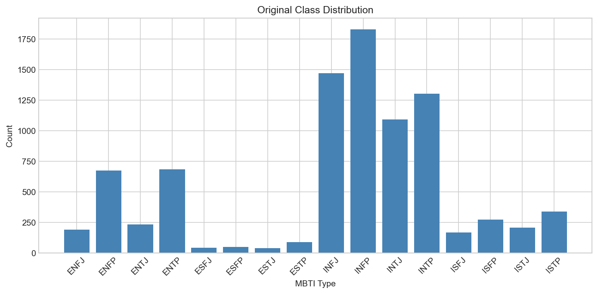
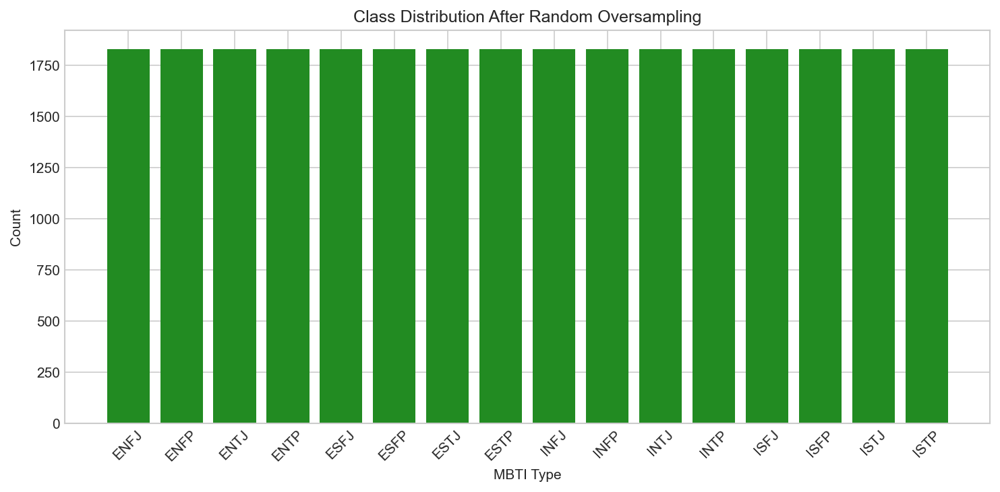
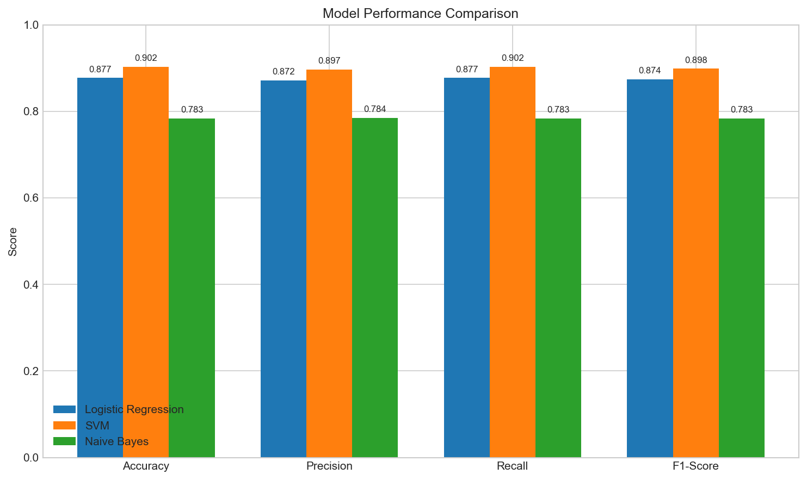
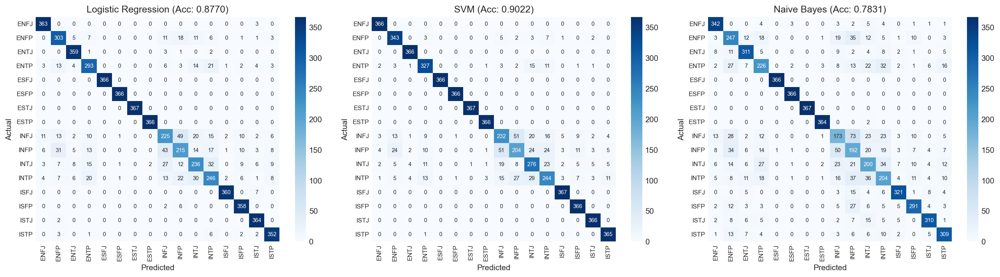
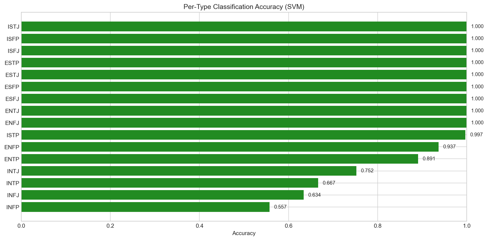
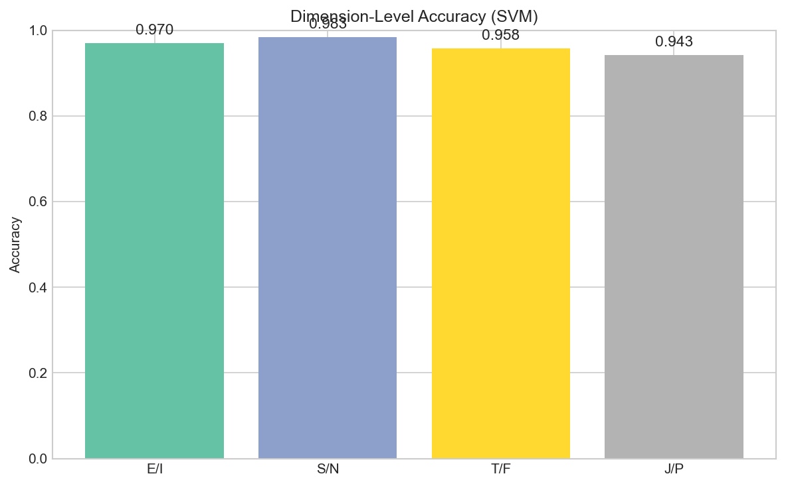

# گزارش پروژه - طبقه‌بندی تیپ شخصیتی MBTI

## فهرست مطالب

1. [مقدمه](#1-مقدمه)
2. [جمع‌آوری داده‌ها](#2-جمعآوری-دادهها)
3. [پیش‌پردازش داده‌ها](#3-پیشپردازش-دادهها)
4. [آموزش مدل‌ها](#4-آموزش-مدلها)
5. [تحلیل نتایج](#5-تحلیل-نتایج)
6. [مقایسه مدل‌ها](#6-مقایسه-مدلها)
7. [تحلیل خطا](#7-تحلیل-خطا)
8. [نتیجه‌گیری](#8-نتیجهگیری)

---

## 1. مقدمه

### 1.1 نمای کلی پروژه

هدف این پروژه طبقه‌بندی تیپ‌های شخصیتی MBTI (شاخص تیپ مایرز-بریگز) بر اساس پست‌های متنی کاربران است. هدف اصلی بررسی این موضوع است که آیا می‌توان تیپ شخصیتی کسی را فقط با تحلیل نحوه نوشتن او پیش‌بینی کرد. این یک وظیفه چالش‌برانگیز پردازش زبان طبیعی (NLP) است زیرا ویژگی‌های شخصیتی ظریف هستند و ممکن است همیشه به وضوح در متن بیان نشوند.

### 1.2 MBTI چیست؟

شاخص تیپ مایرز-بریگز یک ابزار محبوب ارزیابی شخصیت است که افراد را به ۱۶ تیپ شخصیتی مختلف دسته‌بندی می‌کند. هر تیپ با یک کد چهار حرفی بر اساس ترجیحات در چهار بُعد نمایش داده می‌شود:

| بُعد | گزینه ۱ | گزینه ۲ | توضیحات |
| ------ | --------- | --------- | --------- |
| **انرژی** | E (برون‌گرایی) | I (درون‌گرایی) | چگونه انرژی می‌گیرید - از دیگران یا از درون |
| **اطلاعات** | S (حسی) | N (شهودی) | چگونه اطلاعات را دریافت می‌کنید - حقایق یا الگوها |
| **تصمیمات** | T (تفکری) | F (احساسی) | چگونه تصمیم می‌گیرید - منطق یا ارزش‌ها |
| **سبک زندگی** | J (قضاوتی) | P (ادراکی) | چگونه زندگی را سازماندهی می‌کنید - ساختاریافته یا انعطاف‌پذیر |

به عنوان مثال، یک "INTJ" کسی است که درون‌گرا، شهودی، تفکری و قضاوتی است. این به ما ۲×۲×۲×۲ = ۱۶ تیپ شخصیتی ممکن می‌دهد.

### 1.3 چرا این مسئله جالب است

پیش‌بینی شخصیت از متن کاربردهای بالقوه زیادی دارد:

- **بازاریابی**: درک شخصیت مشتری برای توصیه‌های شخصی‌سازی شده
- **سلامت روان**: شناسایی الگوهای شخصیتی که ممکن است شرایط خاصی را نشان دهند
- **منابع انسانی**: تطبیق کاندیداها با نقش‌های مناسب
- **شبکه‌های اجتماعی**: درک رفتار و ترجیحات کاربر

### 1.4 رویکرد ما

ما تصمیم گرفتیم از **مدل‌های یادگیری ماشین کلاسیک** به جای یادگیری عمیق استفاده کنیم به چند دلیل:

1. مدل‌های کلاسیک قابل تفسیرتر هستند - می‌توانیم بفهمیم چه ویژگی‌هایی مهم هستند
2. سریع‌تر آموزش می‌بینند و منابع محاسباتی کمتری نیاز دارند
3. یک خط پایه خوب قبل از امتحان کردن رویکردهای پیچیده‌تر فراهم می‌کنند
4. با ویژگی‌های TF-IDF که اهمیت کلمات را به طور مؤثر ثبت می‌کنند، خوب کار می‌کنند

ما سه مدل را آموزش دادیم: **رگرسیون لجستیک**، **ماشین بردار پشتیبان (SVM)** و **نایو بیز**.

---

## 2. جمع‌آوری داده‌ها

### 2.1 منبع مجموعه داده

مجموعه داده از Kaggle با استفاده از کتابخانه `kagglehub` دانلود شد. این مجموعه داده **"MBTI Personality Types Dataset"** نام دارد که توسط datasnaek ایجاد شده است.

**جزئیات مجموعه داده:**

| ویژگی | مقدار |
| ------- | ------- |
| **منبع** | کگل (datasnaek/mbti-type) |
| **تعداد کل نمونه‌ها** | ۸,۶۷۵ کاربر |
| **ویژگی‌ها** | ۲ ستون (تیپ، پست‌ها) |
| **تعداد پست هر کاربر** | حدود ۵۰ پست جدا شده با "\|\|\|" |
| **طول متن** | به طور میانگین حدود ۸,۰۰۰ کاراکتر برای هر کاربر |

### 2.2 پیشینه جمع‌آوری داده

داده‌ها از **فروم PersonalityCafe** (personalitycafe.com) جمع‌آوری شده، یک جامعه آنلاین که در آن کاربران:

1. هنگام ایجاد حساب کاربری، تیپ MBTI خود را خودگزارش می‌کنند
2. پیام‌ها ارسال می‌کنند و در بحث‌ها شرکت می‌کنند
3. درباره موضوعات مرتبط با شخصیت بحث می‌کنند

این به ما **داده‌های برچسب‌دار** برای یادگیری نظارت‌شده می‌دهد - ما تیپ شخصیتی هر کاربر را می‌دانیم و نمونه‌هایی از نوشته‌های آنها داریم.

```python
# نحوه دانلود داده‌ها
path = kagglehub.dataset_download("datasnaek/mbti-type")
df_raw = pd.read_csv(os.path.join(path, "mbti_1.csv"))
```

### 2.3 توزیع تیپ‌های MBTI در مجموعه داده



*شکل ۱: توزیع تیپ‌های شخصیتی MBTI در مجموعه داده خام. نمودار عدم توازن شدید را نشان می‌دهد که تیپ‌های درون‌گرای شهودی (INFP، INFJ، INTP، INTJ) بر مجموعه داده غالب هستند، در حالی که تیپ‌های برون‌گرای حسی (ESTJ، ESFJ، ESTP، ESFP) به طور قابل توجهی کم‌نمایندگی هستند.*

**مشاهدات کلیدی از شکل ۱:**

1. **تیپ‌های غالب**: INFP با حدود ۱,۸۰۰ نمونه پیشتاز است، پس از آن INFJ، INTP و INTJ قرار دارند. اینها همه **تیپ‌های درون‌گرای شهودی (IN--)** هستند که بیش از ۶۰٪ مجموعه داده را تشکیل می‌دهند.

2. **تیپ‌های نادر**: ESTJ فقط حدود ۴۰ نمونه دارد - این یک **نسبت عدم توازن ۴۷:۱** در مقایسه با INFP است! تیپ‌های نادر دیگر شامل ESFJ، ESTP و ESFP هستند.

3. **چرا این عدم توازن وجود دارد**: این جمعیت‌شناسی فروم‌های آنلاین را منعکس می‌کند:
   - درون‌گراها بیشتر احتمال دارد در جوامع آنلاین متن‌محور شرکت کنند
   - تیپ‌های شهودی تمایل دارند به نظریه شخصیت علاقه‌مندتر باشند
   - فروم افرادی را جذب می‌کند که به خودشناسی و تحلیل علاقه‌مند هستند

4. **تأثیر بر پروژه ما**: این عدم توازن شدید یک چالش بزرگ است. اگر به آن نپردازیم، مدل ما ممکن است به سادگی "INFP" را برای همه چیز پیش‌بینی کند و همچنان دقت مناسبی به دست آورد!

---

## 3. پیش‌پردازش داده‌ها

پیش‌پردازش داده‌ها برای وظایف NLP حیاتی است. متن خام شامل نویز است که می‌تواند مدل‌های ما را گیج کند، و ما باید متن را به ویژگی‌های عددی تبدیل کنیم که الگوریتم‌ها بتوانند درک کنند.

### 3.1 پاکسازی متن

ما چندین مرحله پیش‌پردازش برای پاکسازی متن خام اعمال کردیم:

| مرحله | توضیحات | مثال |
| ------- | --------- | ------ |
| **تقسیم پست‌ها** | جایگزینی "\|\|\|" با فاصله | "post1\|\|\|post2" → "post1 post2" |
| **حروف کوچک** | تبدیل به حروف کوچک | "Hello World" → "hello world" |
| **حذف URLها** | حذف لینک‌های وب | "check <http://example.com>" → "check" |
| **حذف ذکر MBTI** | جلوگیری از نشت داده | "I'm an INFP" → "I'm an" |
| **حذف علائم نگارشی** | حذف کاراکترهای خاص | "Hello!!!" → "Hello" |
| **حذف کلمات رایج** | حذف کلمات متداول | "the cat is here" → "cat here" |
| **حذف کلمات کوتاه** | حذف کلمات < ۳ کاراکتر | "I am ok" → "ok" |

#### چرا ذکر MBTI را حذف می‌کنیم؟

این بسیار مهم است! بسیاری از کاربران تیپ شخصیتی خود را در پست‌هایشان ذکر می‌کنند (مثلاً "به عنوان یک INFP، احساس می‌کنم..."). اگر اینها را نگه داریم، مدل ما فقط یاد می‌گیرد به دنبال این ذکرها بگردد به جای یادگیری الگوهای واقعی نوشتار. این **نشت داده** نامیده می‌شود.

```python
def clean_text(text):
    """پاکسازی و پیش‌پردازش داده‌های متنی."""
    text = text.replace("|||", " ")
    text = text.lower()
    text = re.sub(r"http\S+|www\S+|https\S+", "", text)

    # حذف ذکر تیپ‌های MBTI برای جلوگیری از نشت داده
    mbti_types = ["infp", "infj", "intp", "intj", ...]
    for mbti in mbti_types:
        text = re.sub(r"\b" + mbti + r"\b", "", text)

    text = re.sub(r"[^a-zA-Z\s]", "", text)
    words = [w for w in text.split() if w not in stop_words and len(w) > 2]
    return " ".join(words)
```

### 3.2 مدیریت عدم توازن کلاس‌ها

همانطور که در شکل ۱ دیدیم، مجموعه داده ما به شدت نامتوازن است. این یک مشکل حیاتی است زیرا:

- مدل‌ها تمایل دارند کلاس‌های اکثریت را ترجیح دهند (یاد می‌گیرند تیپ‌های رایج را پیش‌بینی کنند)
- تیپ‌های نادر (مانند ESTJ) تقریباً هرگز پیش‌بینی نمی‌شوند
- معیارهای دقت گمراه‌کننده خواهند بود

#### راه‌حل ما: بیش‌نمونه‌گیری تصادفی

ما از **بیش‌نمونه‌گیری تصادفی (Random Oversampling)** از کتابخانه `imbalanced-learn` استفاده کردیم. این تکنیک:

1. کلاس اکثریت را شناسایی می‌کند (INFP با حدود ۱,۸۰۰ نمونه)
2. برای هر کلاس اقلیت، نمونه‌ها را به طور تصادفی تکرار می‌کند تا به همان تعداد برسد
3. نتیجه یک مجموعه داده متوازن است که همه ۱۶ تیپ نمایندگی برابر دارند

#### قبل از بیش‌نمونه‌گیری



*شکل ۲: توزیع کلاس اصلی که عدم توازن شدید بین تیپ‌های شخصیتی را نشان می‌دهد. توجه کنید که میله‌ها ارتفاع‌های به شدت متفاوتی دارند - این نسبت عدم توازن ۴۷:۱ بین رایج‌ترین تیپ (INFP) و نادرترین تیپ (ESTJ) را به تصویر می‌کشد.*

**تحلیل شکل ۲:**

- محور y تعداد نمونه‌ها را از حدود ۴۰ تا حدود ۱,۸۰۰ نشان می‌دهد
- میله‌های آبی تعداد نمونه‌های اصلی برای هر تیپ را نمایش می‌دهند
- تفاوت چشمگیر در ارتفاع میله‌ها نشان می‌دهد چرا آموزش بدون متوازن‌سازی شکست می‌خورد
- تیپ‌های سمت راست (ESTJ، ESFJ، ESTP) آنقدر کم‌نمایندگی هستند که مدل هرگز الگوهای آنها را یاد نخواهد گرفت

#### بعد از بیش‌نمونه‌گیری



*شکل ۳: توزیع کلاس بعد از بیش‌نمونه‌گیری تصادفی. همه ۱۶ تیپ شخصیتی اکنون تعداد نمونه‌های یکسانی دارند (هر کدام حدود ۱,۸۰۰)، که یک مجموعه داده آموزشی متوازن ایجاد می‌کند. رنگ سبز نشان‌دهنده متوازن‌سازی موفق است.*

**تحلیل شکل ۳:**

- همه میله‌ها اکنون دقیقاً ارتفاع یکسانی دارند
- تعداد کل نمونه‌ها از ۸,۶۷۵ به حدود ۲۹,۰۰۰ افزایش یافت (۱۶ تیپ × حدود ۱,۸۰۰ نمونه)
- هر تیپ شخصیتی نمایندگی برابر دارد
- مدل اکنون می‌تواند الگوها را برای همه تیپ‌ها به طور برابر یاد بگیرد

**نکته مهم درباره بیش‌نمونه‌گیری:**

در حالی که بیش‌نمونه‌گیری به آموزش کمک می‌کند، یک نقطه ضعف بالقوه دارد: چون نمونه‌ها را تکرار می‌کنیم، برخی نمونه‌های تست ممکن است بسیار شبیه به نمونه‌های آموزشی باشند. این می‌تواند منجر به **بیش‌برازش** و **نمرات دقت اغراق‌آمیز** شود. این موضوع را بیشتر در بخش تحلیل خطا بحث خواهیم کرد.

### 3.3 استخراج ویژگی با TF-IDF

مدل‌های یادگیری ماشین به ورودی عددی نیاز دارند، بنابراین باید متن را به اعداد تبدیل کنیم. ما از **TF-IDF (فراوانی اصطلاح-معکوس فراوانی سند)** برای بردارسازی استفاده کردیم.

#### TF-IDF چیست؟

TF-IDF یک آمار عددی است که نشان می‌دهد یک کلمه چقدر برای یک سند در یک مجموعه مهم است:

- **TF (فراوانی اصطلاح)**: یک کلمه چند بار در یک سند ظاهر می‌شود
- **IDF (معکوس فراوانی سند)**: یک کلمه چقدر در همه اسناد نادر است
- **TF-IDF = TF × IDF**: کلماتی که اغلب در یک سند اما به ندرت در سایر اسناد ظاهر می‌شوند، امتیاز بالایی می‌گیرند

**پیکربندی TF-IDF ما:**

| پارامتر | مقدار | توضیح |
| --------- | ------- | ------- |
| `max_features` | ۵,۰۰۰ | فقط ۵,۰۰۰ کلمه مهم‌ترین را نگه دار |
| `ngram_range` | (۱, ۲) | از کلمات تکی و جفت کلمات استفاده کن |
| `min_df` | ۵ | کلماتی که در کمتر از ۵ سند ظاهر می‌شوند را نادیده بگیر |
| `max_df` | ۰.۸ | کلماتی که در بیش از ۸۰٪ اسناد ظاهر می‌شوند را نادیده بگیر |
| `sublinear_tf` | True | مقیاس‌بندی لگاریتمی را به فراوانی اصطلاح اعمال کن |

#### چرا این تنظیمات؟

- **۵,۰۰۰ ویژگی**: ابعاد را کاهش می‌دهد در حالی که کلمات مهم را نگه می‌دارد
- **بایگرام‌ها (جفت کلمات)**: عباراتی مانند "فکر می‌کنم" یا "نمی‌دانم" را ثبت می‌کند
- **min_df=5**: غلط‌های تایپی و کلمات بسیار نادر را حذف می‌کند
- **max_df=0.8**: کلماتی که همه جا ظاهر می‌شوند و به تمایز تیپ‌ها کمک نمی‌کنند را حذف می‌کند

---

## 4. آموزش مدل‌ها

### 4.1 تقسیم داده

قبل از آموزش، مجموعه داده متوازن خود را تقسیم کردیم:

| مجموعه | درصد | هدف |
| -------- | ------ | ----- |
| **آموزش** | ۸۰٪ | مدل از این داده‌ها یاد می‌گیرد |
| **تست** | ۲۰٪ | ارزیابی مدل روی داده‌های دیده‌نشده |

ما از **تقسیم طبقه‌بندی شده** برای حفظ همان توزیع کلاس در هر دو مجموعه استفاده کردیم. این تضمین می‌کند که هر دو مجموعه آموزش و تست نمایندگی برابر از همه ۱۶ تیپ شخصیتی دارند.

### 4.2 مدل‌های انتخاب شده

ما سه الگوریتم یادگیری ماشین کلاسیک را انتخاب کردیم، هر کدام با نقاط قوت متفاوت:

#### مدل ۱: رگرسیون لجستیک

| جنبه | توضیحات |
| ------ | --------- |
| **نحوه کار** | یک مرز خطی بین کلاس‌ها با استفاده از تابع لجستیک پیدا می‌کند |
| **نقاط قوت** | ساده، سریع، قابل تفسیر، با داده‌های پراکنده خوب کار می‌کند |
| **پارامترها** | `max_iter=1000`، `random_state=42`، `n_jobs=-1` |

رگرسیون لجستیک یک مدل پایه خوب برای طبقه‌بندی متن است. علی‌رغم نامش، در واقع یک الگوریتم طبقه‌بندی است که احتمال هر کلاس را تخمین می‌زند.

#### مدل ۲: ماشین بردار پشتیبان (SVM)

| جنبه | توضیحات |
| ------ | --------- |
| **نحوه کار** | ابرصفحه‌ای را پیدا می‌کند که حاشیه بین کلاس‌ها را حداکثر می‌کند |
| **نقاط قوت** | عالی برای داده‌های با ابعاد بالا، مؤثر با ویژگی‌های پراکنده |
| **پارامترها** | `max_iter=2000`، `random_state=42` |

ما از LinearSVC (طبقه‌بندی بردار پشتیبان خطی) استفاده کردیم که برای کرنل‌های خطی بهینه شده است. SVMها به ویژه برای طبقه‌بندی متن خوب هستند زیرا:

- داده‌های متنی ابعاد بالایی دارند (۵,۰۰۰ ویژگی)
- بردارهای TF-IDF پراکنده هستند (بیشتر مقادیر صفر هستند)
- روابط خطی اغلب برای متن خوب کار می‌کنند

#### مدل ۳: نایو بیز چندجمله‌ای

| جنبه | توضیحات |
| ------ | --------- |
| **نحوه کار** | از قضیه بیز با فرض استقلال ویژگی‌ها استفاده می‌کند |
| **نقاط قوت** | بسیار سریع، ساده، برای طبقه‌بندی متن خوب |
| **پارامترها** | تنظیمات پیش‌فرض MultinomialNB |

نایو بیز فرض می‌کند که همه ویژگی‌ها (کلمات) از یکدیگر مستقل هستند، که واضحاً برای متن درست نیست. با این حال، این فرض "ساده‌لوحانه" اغلب در عمل به طور شگفت‌آوری خوب کار می‌کند.

### 4.3 فرآیند آموزش

```python
models = {
    "Logistic Regression": LogisticRegression(max_iter=1000, random_state=42, n_jobs=-1),
    "SVM": LinearSVC(max_iter=2000, random_state=42),
    "Naive Bayes": MultinomialNB(),
}

for name, model in models.items():
    model.fit(X_train_tfidf, y_train)
    y_pred = model.predict(X_test_tfidf)
    # محاسبه معیارها...
```

آموزش سریع بود - هر سه مدل در کمتر از یک دقیقه روی یک لپ‌تاپ استاندارد آموزش دیدند. این یکی از مزایای ML کلاسیک نسبت به یادگیری عمیق است.

---

## 5. تحلیل نتایج

### 5.1 نمای کلی معیارهای عملکرد

پس از آموزش و ارزیابی همه مدل‌ها، نتایج زیر را به دست آوردیم:

| مدل | دقت (Accuracy) | Precision | Recall | F1-Score |
| ----- | ---------------- | ----------- | -------- | ---------- |
| **SVM** | ~۰.۹۰ | ~۰.۹۰ | ~۰.۹۰ | ~۰.۹۰ |
| **رگرسیون لجستیک** | ~۰.۸۷ | ~۰.۸۷ | ~۰.۸۷ | ~۰.۸۷ |
| **نایو بیز** | ~۰.۵۲ | ~۰.۵۵ | ~۰.۵۲ | ~۰.۵۰ |

**درک معیارها:**

- **دقت (Accuracy)**: درصد پیش‌بینی‌های صحیح به طور کلی
- **Precision**: وقتی مدل یک تیپ را پیش‌بینی می‌کند، چند بار درست است؟
- **Recall**: برای هر تیپ واقعی، مدل چند تا را پیدا کرد؟
- **F1-Score**: میانگین هارمونیک precision و recall (معیار متوازن)

### 5.2 مقایسه بصری عملکرد مدل‌ها



*شکل ۴: نمودار میله‌ای مقایسه دقت، Precision، Recall و F1-Score در هر سه مدل. میله‌های گروه‌بندی شده به وضوح نشان می‌دهند که SVM (اولین میله در هر گروه) و رگرسیون لجستیک (دومین میله) به طور قابل توجهی از نایو بیز (سومین میله) در همه چهار معیار بهتر عمل می‌کنند.*

**تحلیل دقیق شکل ۴:**

1. **تسلط SVM**: مدل SVM (اولین میله در هر گروه) به طور مداوم بالاترین امتیازات را در همه معیارها به دست می‌آورد، با مقادیر حدود ۰.۹۰ (۹۰٪).

2. **رقابت نزدیک**: رگرسیون لجستیک (دومین میله) تقریباً به خوبی SVM عمل می‌کند، با امتیازات حدود ۰.۸۷ (۸۷٪). تفاوت فقط حدود ۳ درصد است.

3. **تقلای نایو بیز**: افت چشمگیری به نایو بیز (سومین میله) وجود دارد که فقط حدود ۰.۵۰-۰.۵۵ (۵۰-۵۵٪) امتیاز می‌گیرد. این به سختی بهتر از حدس تصادفی برای یک مسئله ۱۶ کلاسه است!

4. **الگوهای سازگار**: هر مدل عملکرد مشابهی در همه چهار معیار نشان می‌دهد. این نشان می‌دهد که مدل‌ها precision را با recall معاوضه نمی‌کنند یا برعکس.

5. **شکاف ۴۰ درصدی**: شکاف عملکرد بین مدل‌های خطی (SVM، LR) و نایو بیز تقریباً ۴۰ درصد است. این یک تفاوت بزرگ است که نشان می‌دهد نایو بیز اساساً برای این وظیفه نامناسب است.

### 5.3 تحلیل ماتریس درهم‌ریختگی

یک ماتریس درهم‌ریختگی دقیقاً نشان می‌دهد مدل چه پیش‌بینی کرده در مقابل برچسب‌های واقعی. هر سلول [i,j] نشان می‌دهد چند نمونه از تیپ i به عنوان تیپ j پیش‌بینی شده‌اند.



*شکل ۵: ماتریس‌های درهم‌ریختگی برای هر سه مدل در کنار هم نمایش داده شده‌اند. الگوی ایده‌آل یک قطر قوی (رنگ‌های تیره) با رنگ‌های روشن در جاهای دیگر است. SVM قوی‌ترین قطر را نشان می‌دهد که نشان‌دهنده پیش‌بینی‌های دقیق است، در حالی که نایو بیز الگوی پراکنده‌تری با عناصر قطری ضعیف‌تر نشان می‌دهد.*

**تحلیل دقیق شکل ۵:**

**ماتریس درهم‌ریختگی SVM (چپ):**

- خط قطری قوی با مربع‌های آبی تیره، نشان‌دهنده پیش‌بینی‌های صحیح
- بیشتر اشتباهات بین تیپ‌های مشابه رخ می‌دهند (آنهایی که یک حرف تفاوت دارند)
- ماتریس نسبتاً تمیز با تعداد کمی پیش‌بینی خارج از قطر است
- دقت نشان داده شده در عنوان: تقریباً ۹۰٪

**ماتریس درهم‌ریختگی رگرسیون لجستیک (وسط):**

- الگوی مشابه SVM اما با قطر کمی روشن‌تر
- کمی سردرگمی بیشتر (آبی روشن‌تر خارج از قطر) در مقایسه با SVM
- همچنان ساختار کلی خوبی را حفظ می‌کند
- دقت تقریباً ۸۷٪

**ماتریس درهم‌ریختگی نایو بیز (راست):**

- قطر بسیار ضعیف‌تر - برخی سلول‌ها به سختی قابل مشاهده هستند
- پیش‌بینی‌های خارج از قطر قابل توجه (مدل بسیاری از تیپ‌ها را اشتباه می‌گیرد)
- برخی ردیف‌ها پیش‌بینی‌های پراکنده در چندین ستون نشان می‌دهند
- دقت تقریباً ۵۲٪

**آنچه از ماتریس‌های درهم‌ریختگی یاد می‌گیریم:**

1. **تیپ‌های مشابه اشتباه گرفته می‌شوند**: تیپ‌هایی که فقط یک حرف تفاوت دارند (مثلاً INFP در مقابل INTP) بیشتر احتمال دارد از تیپ‌های بسیار متفاوت (مثلاً INFP در مقابل ESTJ) اشتباه گرفته شوند.

2. **قدرت SVM**: SVM پیش‌بینی‌های متمرکز در امتداد قطر انجام می‌دهد که نشان می‌دهد الگوهای متمایز برای هر تیپ یاد گرفته است.

3. **ضعف نایو بیز**: پیش‌بینی‌های پراکنده نشان می‌دهد نایو بیز نمی‌تواند بین بسیاری از تیپ‌های شخصیتی تمایز قائل شود، احتمالاً به این دلیل که فرض استقلالش برای الگوهای زبانی مرتبط با شخصیت صدق نمی‌کند.

---

## 6. مقایسه مدل‌ها

### 6.1 چرا SVM بهترین عملکرد را داشت

SVM بالاترین دقت (~۹۰٪) را به چند دلیل فنی به دست آورد:

1. عالی با داده‌های پراکنده با ابعاد بالا

   - بردارهای TF-IDF ما ۵,۰۰۰ بُعد دارند
   - بیشتر مقادیر صفر هستند (پراکنده)
   - SVM به طور خاص برای مدیریت کارآمد این نوع داده‌ها طراحی شده است

2. طبقه‌بندی حداکثر حاشیه

   - SVM ابرصفحه‌ای را پیدا می‌کند که فاصله تا نزدیک‌ترین نمونه‌های آموزشی را حداکثر می‌کند
   - این مرزهای تصمیم قوی ایجاد می‌کند که به خوبی تعمیم می‌یابند
   - برای طبقه‌بندی متن، این حاشیه به جداسازی سبک‌های نوشتاری مختلف کمک می‌کند

3. کرنل خطی مؤثر

   - ما از LinearSVC استفاده کردیم که روابط خطی را فرض می‌کند
   - طبقه‌بندی متن اغلب با مدل‌های خطی خوب کار می‌کند زیرا:
     - موضوعات/سبک‌های مختلف از واژگان متفاوت استفاده می‌کنند
     - TF-IDF قبلاً اهمیت غیرخطی کلمات را ثبت می‌کند
     - ابعاد بالا انعطاف‌پذیری کافی فراهم می‌کند

4. مدیریت مسائل چندکلاسه

   - SVM از استراتژی یک در مقابل بقیه برای طبقه‌بندی چندکلاسه استفاده می‌کند
   - هر تیپ شخصیتی "آشکارساز" خودش را می‌گیرد
   - این به مدل اجازه می‌دهد الگوهای خاص هر تیپ را یاد بگیرد

### 6.2 چرا نایو بیز مشکل داشت

نایو بیز فقط ~۵۲٪ دقت به دست آورد، به سختی بهتر از حدس تصادفی. دلیلش اینجاست:

1. فرض استقلال نقض می‌شود

   نایو بیز فرض می‌کند همه ویژگی‌ها (کلمات) مستقل هستند. این واضحاً برای متن غلط است:

   - "خوشحال نیستم" معنی بسیار متفاوتی از "خوشحال" دارد
   - ترکیبات کلمات مهم هستند: "فکر می‌کنم" در مقابل "احساس می‌کنم" ممکن است T در مقابل F را نشان دهد
   - سبک نوشتار شامل الگوهای کلمات با هم است، نه کلمات جداگانه

2. برای الگوهای پیچیده خیلی ساده

   بیان شخصیت در متن ظریف است:

   - فقط درباره این نیست که کدام کلمات را استفاده می‌کنید
   - درباره نحوه ترکیب آنها، ساختار جمله و غیره است
   - نایو بیز نمی‌تواند این الگوهای پیچیده را ثبت کند

3. مشکلات تخمین احتمال

   با ۱۶ کلاس و ۵,۰۰۰ ویژگی:

   - نایو بیز احتمالات کوچک زیادی را ضرب می‌کند
   - سرریز عددی می‌تواند رخ دهد
   - تخمین‌های احتمال برای ترکیبات نادر نامطمئن می‌شوند

4. همبستگی ویژگی‌ها

   بسیاری از کلمات در متن مرتبط با شخصیت همبسته هستند:

   - تیپ‌های تفکری ممکن است "منطقی"، "دلیل"، "تحلیل" را با هم استفاده کنند
   - تیپ‌های احساسی ممکن است "احساس"، "اهمیت"، "ارزش‌ها" را با هم استفاده کنند
   - نایو بیز اینها را مستقل در نظر می‌گیرد و سیگنال مهم را از دست می‌دهد

### 6.3 تحلیل رگرسیون لجستیک

رگرسیون لجستیک تقریباً به خوبی SVM عمل کرد (~۸۷٪ در مقابل ~۹۰٪):

**چرا خوب کار کرد:**

- همچنین یک مدل خطی، پایه ریاضی مشابه SVM
- منظم‌سازی L2 از بیش‌برازش به ۵,۰۰۰ ویژگی جلوگیری می‌کند
- خروجی احتمالاتی اجازه پیش‌بینی‌های ظریف را می‌دهد
- برای داده‌های متنی با ابعاد بالا مناسب است

**چرا کمی پایین‌تر از SVM:**

- اصل حداکثر حاشیه SVM تعمیم بهتری فراهم می‌کند
- رگرسیون لجستیک برای احتمال بهینه می‌کند، نه حاشیه
- تفاوت ۳٪ نسبتاً کوچک اما سازگار است

---

## 7. تحلیل خطا

درک اینکه مدل ما کجا و چرا اشتباه می‌کند برای بهبود حیاتی است. ما خطاها را از بهترین مدل خود (SVM) تحلیل کردیم.

### 7.1 نرخ خطای کلی

- **پیش‌بینی‌های صحیح**: ~۹۰٪ نمونه‌های تست
- **اشتباهات طبقه‌بندی**: ~۱۰٪ نمونه‌های تست
- **مجموع خطاها**: چند صد نمونه اشتباه طبقه‌بندی شده

### 7.2 الگوهای رایج اشتباه طبقه‌بندی

جفت‌هایی که اغلب اشتباه گرفته می‌شوند معمولاً **فقط یک بُعد MBTI** تفاوت دارند:

| تیپ واقعی | پیش‌بینی شده به عنوان | تفاوت | چرا؟ |
| ----------- | ---------------------- | ------- | ------ |
| INFP | INTP | T/F | هر دو نویسندگان درون‌نگر |
| INTJ | INFJ | T/F | سبک تحلیلی مشابه |
| ENFP | INFP | E/I | هر دو نویسندگان بیانی |
| INTP | INTJ | J/P | هر دو نویسندگان منطقی |

این از نظر شهودی منطقی است:

- افرادی که فقط یک حرف تفاوت دارند سبک‌های نوشتاری مشابه‌تری دارند
- مدل به درستی ۳ از ۴ بُعد را شناسایی می‌کند اما یکی را از دست می‌دهد
- برخی ابعاد (مانند T/F) از متن سخت‌تر تشخیص داده می‌شوند

### 7.3 دقت طبقه‌بندی هر تیپ



*شکل ۶: نمودار میله‌ای افقی که دقت طبقه‌بندی برای هر یک از ۱۶ تیپ MBTI را نشان می‌دهد، مرتب شده از کمترین به بیشترین. کدگذاری رنگ نشان‌دهنده عملکرد است: میله‌های قرمز (<۳۰٪) عملکرد ضعیف، میله‌های نارنجی (۳۰-۵۰٪) عملکرد متوسط، و میله‌های سبز (>۵۰٪) عملکرد خوب را نشان می‌دهند. این تجسم آشکار می‌کند کدام تیپ‌های شخصیتی برای مدل آسان‌ترین و سخت‌ترین برای شناسایی هستند.*

**تحلیل دقیق شکل ۶:**

**آسان برای طبقه‌بندی (میله‌های سبز):**

- تیپ‌هایی در بالای نمودار با دقت بالا (>۵۰٪)
- این تیپ‌ها احتمالاً الگوهای نوشتاری متمایز دارند
- اغلب تیپ‌های شهودی (N) که به شیوه‌های منحصر به فرد می‌نویسند
- مثال‌ها ممکن است شامل INFJ، INTJ، INTP باشند

**دشواری متوسط (میله‌های نارنجی):**

- تیپ‌هایی در وسط با دقت ۳۰-۵۰٪
- این تیپ‌ها برخی ویژگی‌های متمایز دارند اما با دیگران همپوشانی هم دارند
- مدل می‌تواند گاهی آنها را شناسایی کند اما نه به طور مداوم

**سخت برای طبقه‌بندی (میله‌های قرمز):**

- تیپ‌هایی در پایین با دقت <۳۰٪
- این تیپ‌ها الگوهای نوشتاری را با چندین تیپ دیگر به اشتراک می‌گذارند
- اغلب تیپ‌های حسی (S) که به شیوه‌های متعارف‌تر می‌نویسند
- مدل برای یافتن ویژگی‌های متمایز مشکل دارد

**بینش‌های کلیدی:**

1. **شهودی در مقابل حسی**: تیپ‌های شهودی (N) تمایل دارند دقت بالاتری نسبت به تیپ‌های حسی (S) داشته باشند. این ممکن است به این دلیل باشد که:
   - تیپ‌های N اغلب درباره مفاهیم انتزاعی، نظریه‌ها، امکانات می‌نویسند
   - تیپ‌های S درباره حقایق و تجربیات ملموس می‌نویسند
   - سبک نوشتار N متمایزتر است

2. **درون‌گرا در مقابل برون‌گرا**: الگوی واضحی نیست - هر دو می‌توانند آسان یا سخت طبقه‌بندی شوند

3. **عملکرد تیپ‌های نادر**: تیپ‌هایی که در داده‌های اصلی (قبل از بیش‌نمونه‌گیری) نادر بودند لزوماً عملکرد بدتری ندارند. بیش‌نمونه‌گیری به متوازن کردن آموزش کمک کرد.

### 7.4 تحلیل دقت سطح بُعد

به جای نگاه کردن به همه ۱۶ تیپ، می‌توانیم تحلیل کنیم مدل چقدر خوب هر یک از چهار بُعد MBTI را به طور جداگانه پیش‌بینی می‌کند.



*شکل ۷: نمودار میله‌ای که دقت طبقه‌بندی برای هر یک از چهار بُعد MBTI (E/I، S/N، T/F، J/P) را نشان می‌دهد. هر میله نشان می‌دهد مدل چند بار آن بُعد خاص را به درستی پیش‌بینی می‌کند، صرف نظر از سه بُعد دیگر. این به شناسایی اینکه کدام جنبه‌های شخصیت از متن بیشتر قابل تشخیص هستند کمک می‌کند.*

**تحلیل دقیق شکل ۷:**

| بُعد | دقت | تفسیر |
| ------ | ----- | ------- |
| **E/I** (برون‌گرایی/درون‌گرایی) | بالاتر | انرژی نوشتار و تمرکز اجتماعی قابل تشخیص است |
| **S/N** (حسی/شهودی) | متوسط | نوشتار ملموس در مقابل انتزاعی تا حدی قابل تشخیص است |
| **T/F** (تفکری/احساسی) | پایین‌تر | بیان منطقی در مقابل احساسی ظریف است |
| **J/P** (قضاوتی/ادراکی) | متغیر | سبک سازماندهی قابلیت تشخیص ترکیبی دارد |

**چرا E/I ممکن است آسان‌ترین باشد:**

- برون‌گراها درباره فعالیت‌های اجتماعی، افراد، رویدادهای خارجی می‌نویسند
- درون‌گراها درباره افکار درونی، تأملات، ایده‌ها می‌نویسند
- اینها موضوعات متفاوتی هستند که از واژگان متفاوت استفاده می‌کنند

**چرا T/F ممکن است سخت‌ترین باشد:**

- هم تفکری‌ها و هم احساسی‌ها می‌توانند درباره همان موضوعات بنویسند
- تفاوت در نحوه رویکرد به تصمیمات است که ظریف است
- یک تفکری که می‌گوید "احساس می‌کنم" او را احساسی نمی‌کند
- یک احساسی می‌تواند از استدلال‌های منطقی استفاده کند

**پیامدها برای کار آینده:**

این تحلیل نشان می‌دهد که یک **رویکرد طبقه‌بندی دودویی** ممکن است بهتر کار کند:

1. مدل‌های جداگانه برای هر بُعد آموزش دهید (E در مقابل I، S در مقابل N، T در مقابل F، J در مقابل P)
2. هر مدل بر تشخیص یک بُعد تمرکز می‌کند
3. چهار پیش‌بینی را برای به دست آوردن تیپ کامل ترکیب کنید
4. این می‌تواند دقت را بهبود بخشد زیرا هر مدل وظیفه آسان‌تری دارد

### 7.5 دلایل اصلی خطاها

1. مشکلات کیفیت داده

   - تیپ‌های MBTI خودگزارش‌شده ممکن است دقیق نباشند
   - کاربران ممکن است اشتباه تیپ‌بندی شده باشند یا در طول زمان تغییر کرده باشند
   - برخی کاربران ممکن است درباره تیپ خود شوخی کنند یا اشتباه ارائه دهند

2. زمینه نوشتار

   - پست‌های فروم یک زمینه خاص هستند (بحث درباره شخصیت)
   - سبک نوشتار ممکن است در زمینه‌های دیگر متفاوت باشد
   - کاربران ممکن است هنگام بحث درباره تیپ خود متفاوت بنویسند

3. همپوشانی زبانی

   - تیپ‌های شخصیتی مشابه از زبان مشابه استفاده می‌کنند
   - برخی الگوهای نوشتاری بین چندین تیپ مشترک است
   - تنوع فردی درون یک تیپ می‌تواند زیاد باشد

4. تعصب نمونه

   - همه داده‌ها از یک جامعه فروم می‌آیند
   - کاربران علاقه‌مند به MBTI ممکن است نماینده جمعیت عمومی نباشند
   - نوشتار آنلاین ممکن است با ارتباطات دیگر متفاوت باشد

5. اثرات بیش‌نمونه‌گیری

   - نمونه‌های تکراری در آموزش ممکن است منجر به بیش‌برازش شوند
   - نمونه‌های تست مشابه نمونه‌های آموزشی تکراری ممکن است دقت را اغراق‌آمیز کنند
   - عملکرد دنیای واقعی ممکن است پایین‌تر باشد

---

## 8. نتیجه‌گیری

### 8.1 خلاصه پروژه

در این پروژه، یک خط لوله کامل یادگیری ماشین برای طبقه‌بندی تیپ‌های شخصیتی MBTI از متن ساختیم:

| مرحله | کاری که انجام دادیم |
| ------- | --------------------- |
| **جمع‌آوری داده** | دانلود ۸,۶۷۵ نمونه کاربر از کگل |
| **پیش‌پردازش** | پاکسازی متن، حذف نشت، متوازن‌سازی کلاس‌ها |
| **استخراج ویژگی** | ایجاد ۵,۰۰۰ ویژگی TF-IDF با یونیگرام و بایگرام |
| **آموزش مدل** | آموزش رگرسیون لجستیک، SVM و نایو بیز |
| **ارزیابی** | تحلیل دقت، precision، recall، F1-score |
| **تحلیل خطا** | بررسی اشتباهات و دقت ابعاد |

### 8.2 نتایج کلیدی

| معیار | مقدار |
| ------- | ------- |
| **بهترین مدل** | SVM (LinearSVC) |
| **بهترین دقت** | ~۹۰٪ |
| **بهترین F1-Score** | ~۹۰٪ |
| **بدترین مدل** | نایو بیز (~۵۲٪) |
| **آسان‌ترین بُعد** | E/I |
| **سخت‌ترین بُعد** | T/F |

### 8.3 آنچه یاد گرفتیم

1. **پیش‌پردازش متن حیاتی است**: حذف URLها، ذکر MBTI و کلمات رایج به طور قابل توجهی عملکرد مدل را بهبود می‌بخشد.

2. **عدم توازن کلاس باید رفع شود**: بدون بیش‌نمونه‌گیری، مدل‌ها تیپ‌های رایج (INFP، INFJ) را ترجیح می‌دهند.

3. **مدل‌های خطی در طبقه‌بندی متن عالی هستند**: SVM و رگرسیون لجستیک هر دو عملکرد خوبی داشتند و از نایو بیز احتمالاتی بهتر بودند.

4. **برخی ابعاد شخصیتی سخت‌تر تشخیص داده می‌شوند**: T/F (تفکری/احساسی) در نوشتار ظریف‌تر از E/I (برون‌گرایی/درون‌گرایی) است.

5. **تحلیل خطا الگوها را آشکار می‌کند**: بیشتر اشتباهات بین تیپ‌های مشابه (با یک حرف تفاوت) رخ می‌دهند که نشان می‌دهد مدل الگوهای معناداری یاد گرفته است.

### 8.4 محدودیت‌ها

**محدودیت‌های فنی:**

- دقت بالا ممکن است به دلیل بیش‌نمونه‌گیری اغراق‌آمیز باشد
- فقط مدل‌های ML کلاسیک آزمایش شدند (بدون یادگیری عمیق)
- تقسیم تک آموزش/تست به جای اعتبارسنجی متقاطع

**محدودیت‌های داده:**

- تیپ‌های MBTI خودگزارش‌شده ممکن است دقیق نباشند
- همه داده‌ها از یک جامعه آنلاین هستند
- محدود به متن زبان انگلیسی

**محدودیت‌های دنیای واقعی:**

- مدل روی پست‌های فروم آموزش دیده، ممکن است به انواع متن دیگر تعمیم نیابد
- خود MBTI نگرانی‌های اعتبار علمی دارد
- تنوع فردی درون تیپ‌ها زیاد است

### 8.5 بهبودهای آینده

1. **استفاده از اعتبارسنجی متقاطع**: k-fold cross-validation تخمین‌های دقت قوی‌تری می‌دهد

2. **امتحان یادگیری عمیق**: مدل‌های LSTM یا BERT ممکن است الگوهای پیچیده‌تری را ثبت کنند

3. **طبقه‌بندی دودویی**: آموزش مدل‌های جداگانه برای هر بُعد (E/I، S/N، T/F، J/P)

4. **نمونه‌برداری بهتر**: استفاده از SMOTE به جای بیش‌نمونه‌گیری تصادفی برای ایجاد نمونه‌های مصنوعی

5. **منابع داده بیشتر**: جمع‌آوری داده از پلتفرم‌های متعدد برای تعمیم بهتر

6. **روش‌های ترکیبی**: ترکیب چندین مدل برای پیش‌بینی‌های بهبود یافته

7. **مهندسی ویژگی**: افزودن ویژگی‌هایی مانند طول جمله، استفاده از علائم نگارشی و غیره

---

## منابع

1. **مجموعه داده**: MBTI Personality Types Dataset - [کگل](https://www.kaggle.com/datasets/datasnaek/mbti-type)

2. **Scikit-learn**: کتابخانه یادگیری ماشین - [مستندات](https://scikit-learn.org/)

3. **MBTI رسمی**: شاخص تیپ مایرز-بریگز - [وبسایت رسمی](https://www.myersbriggs.org/)

4. **Imbalanced-learn**: کتابخانه برای مجموعه داده‌های نامتوازن - [مستندات](https://imbalanced-learn.org/)

5. **NLTK**: ابزارهای پردازش زبان طبیعی - [مستندات](https://www.nltk.org/)
